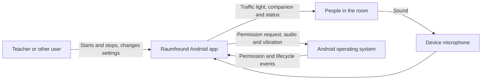
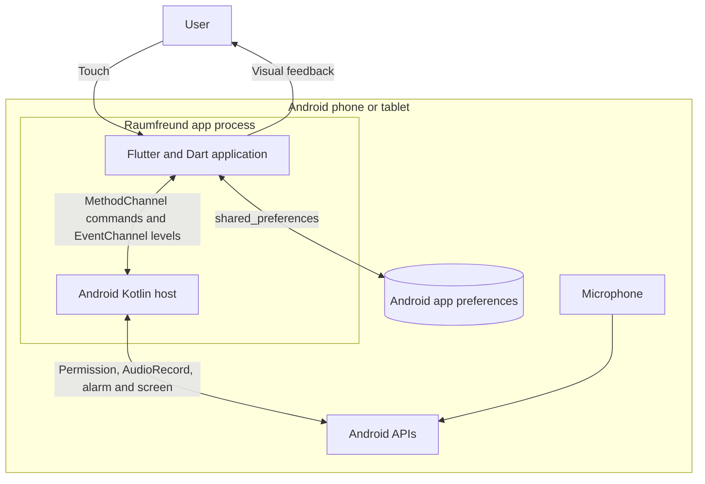
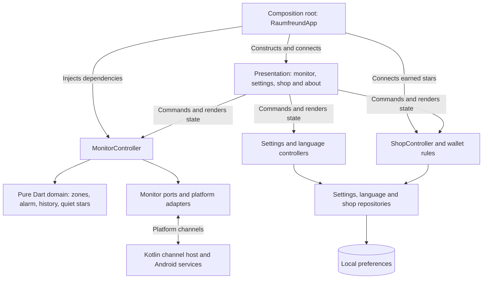
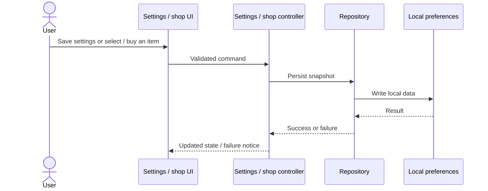
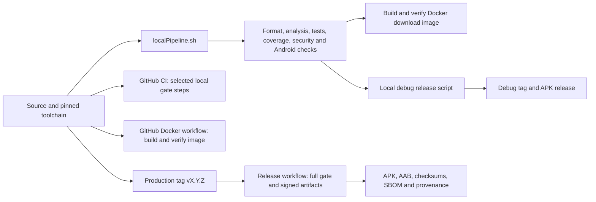

<!--
SPDX-License-Identifier: GPL-3.0-only
Copyright (C) 2026 Marcel Petrick <mail@marcelpetrick.it>
-->

# C4 architecture and flows

This guide explains how Raumfreund is assembled, how a measurement becomes
feedback, and how a build reaches a device. It uses C4's context, container and
component levels, followed by runtime and build flows. Here *container* means
an independently running or stored part of the system, not necessarily a Docker
container. For exact signal and state-machine rules, see
[Measurement](measurement.md), [Architecture](architecture.md) and the
[ADRs](adr/).

## 1. System context

A teacher or other user starts a measurement on an Android phone or tablet.
Children and adults in the room can see the changing traffic light and the
selected companion, Mia or Flocke. The device supplies microphone input and,
if enabled and available, alarm sound and vibration. Android asks for microphone
permission. Settings and rewards stay on the device.



The app is offline: it has no server, account, analytics or advertising, and
its release manifest does not request Internet access. Audio is sampled in
memory, reduced to levels and discarded; it is neither saved nor transmitted.
The levels are estimates, not calibrated sound-pressure measurements. See
[Privacy](privacy.md) and [Measurement](measurement.md).

## 2. Container view



The Flutter and Kotlin parts ship together as one Android app, rather than as
separate deployed services. The Flutter UI and application logic call the
Kotlin host through platform channels; the host uses Android APIs. Preferences
are local persistent storage, not a backend. The chart is a logical view:
Flutter's `shared_preferences` plugin also uses platform integration to reach
Android storage. The separate Docker image used for building and serving an APK
is a development/distribution artifact, not part of the app on the phone.

## 3. Component view inside the app



`lib/main.dart` loads the saved language before the first frame;
`lib/app/raumfreund_app.dart` composes controllers, repositories and platform
adapters. Presentation renders state and sends user commands. The monitor
controller owns asynchronous session, permission and lifecycle coordination;
its domain rules decide zones, alarm timing, history and stars without depending
on widgets, Android APIs or the real clock. Narrow ports allow tests to replace
platform access, clocks and timers with fakes. The Kotlin host owns native
recording, permission, alarm and screen operations. Settings and shop
repositories implement persistence behind their respective interfaces.

The composition root forwards earned stars to the shop without making monitor
domain logic depend on the shop. It also combines the selected pet and equipped
items with monitor state. All visible strings are localized in German, English,
Croatian and Simplified Chinese. Source locations and the dependency direction
are detailed in [Architecture](architecture.md).

## 4. Runtime flows

### Starting, measuring and stopping

```mermaid
sequenceDiagram
    actor User
    participant UI as Flutter UI
    participant Controller as MonitorController
    participant Host as Kotlin host / Android
    participant Rules as Dart domain
    User->>UI: Start measurement
    UI->>Controller: start
    Controller->>Host: Check permission; request if needed
    Host-->>Controller: Permission result
    alt Granted, current session and foreground
        Controller->>Host: Start levels with session ID
        loop Approximately every 100 ms
            Host->>Host: AudioRecord window to RMS / dBFS
            Host-->>Controller: Level and session ID
            Controller->>Rules: Calibrated level and monotonic time
            Rules-->>Controller: Confirmed zone, alarm and star state
            Controller-->>UI: Updated monitor state
        end
    else Denied, stale or not foreground
        Controller-->>UI: Appropriate state; no recording start
    end
    User->>UI: Stop or open another page
    UI->>Controller: Stop and await cleanup
    Controller->>Host: Stop levels
```

A start is serialized and tied to a session ID, so late events or async results
from an old session cannot revive it. A system permission dialog can itself
pause the activity; that pause is handled separately from a genuine background
transition. A detach cancels even a pending permission session. While a running
measurement is backgrounded it stops recording and enters sleep; on returning
to the foreground a new session can resume automatically. Opening Settings,
About or the shop stops measurement and does not auto-restart it on return.
No-reading and recording errors end a session with a visible error. Details and
edge cases are in [ADR 0003](adr/0003-alarm-and-lifecycle-semantics.md),
[ADR 0005](adr/0005-sleep-in-background.md) and
[Platform channels](platform-channels.md).

### Alarm, history and rewards

The native host calculates RMS and dBFS from a short PCM window; only the
numeric level and session ID cross the event channel. The controller calibrates
that level and feeds it to the alarm state machine. Hysteresis confirms the
zone; a separate display envelope and timeline make the view calmer without
changing alarm decisions. Sustained confirmed green earns quiet stars.

An alarm fires only after the configured delay on a qualifying sample. During
its own sound or vibration the controller ignores readings so the output does
not trigger itself; after output ends, a new phase starts from later readings.
If output is enabled, persistent noise can therefore cause another alarm after
a new delay. With both outputs off, the visual alarm occurs once per phase.
When a red alarm fires, the selected companion leaves until green has settled
or the session ends (see [Measurement](measurement.md) for the return rule). The precise hysteresis, gaps and timing are specified in
[ADR 0004](adr/0004-zone-hysteresis.md).

### Saving settings and shop progress



Settings are edited as a draft and saved explicitly; language selection is
stored immediately under its own key. Earned stars, lifetime progress, selected
pet and accessories belong to a versioned wallet. Five lifetime earned stars
raise the shared level, and ten unlock Flocke; spending does not lower it.
Wallet loading and writes are coordinated so that an unavailable or newer
snapshot is not overwritten by an empty one. Failed loads or saves can be
retried. The teacher's confirmed reset clears the wallet and returns selection
to Mia. See [Architecture: Star shop](architecture.md#star-shop).

## 5. Build, checks and distribution



1. On a supported Linux host, `./localPipeline.sh` checks the pinned Flutter
   SDK and tools, resolves locked dependencies, runs formatting and static
   analysis, function-length and tooling checks, tests and the 95% Dart line
   coverage gate. It also runs Android checks, builds APKs, checks privacy and
   licenses, and builds and verifies the Docker image. Logs are written under
   `reports/pipeline/`.
2. GitHub CI splits selected steps from that same script into static, test and
   Android jobs. The Docker workflow separately builds and verifies the image;
   on eligible non-pull-request runs it publishes the verified image to GHCR.
   Docker's build stage runs Dart checks and builds an APK; its final nginx
   image serves a download page and artifacts. This server is separate from the
   offline Android app.
3. For a **debug release**, after a clean pushed commit and green checks,
   `tool/release_debug.sh --dry-run` builds and verifies locally. The normal
   invocation rebuilds, verifies and publishes a `debug-vX.Y.Z-buildN` tag and
   APK. It uses the machine's Android debug certificate so updates can install
   over previous debug releases signed with the same key. It is not a Play or
   production-signed build.
4. A **production release** uses a matching `vX.Y.Z` tag. The release workflow
   checks version consistency, runs the full gate on that commit, uses the
   protected release environment's signing secrets, and produces a signed APK
   and AAB, checksums, an SPDX SBOM and provenance before publishing. Missing
   signing secrets fail the workflow; real-device acceptance remains a separate
   requirement.

See [Building](building.md) for prerequisites and [Releasing](releasing.md)
for commands, signing, verification and rollback. Passing automated checks does
not establish real-device microphone, lifecycle or accessibility behaviour;
those checks remain listed in [Testing](testing.md).
