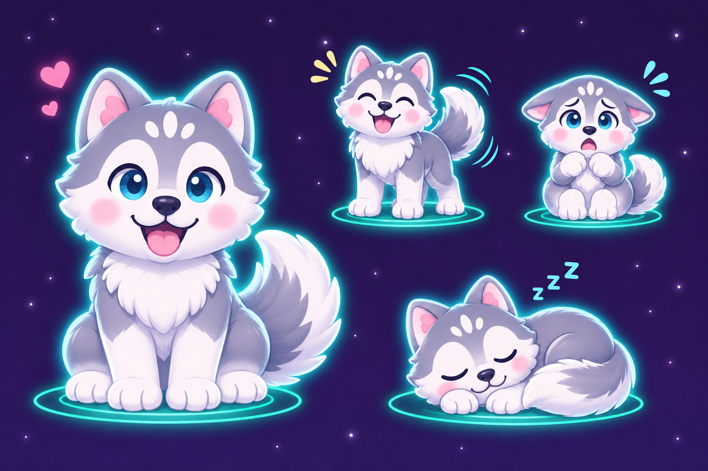
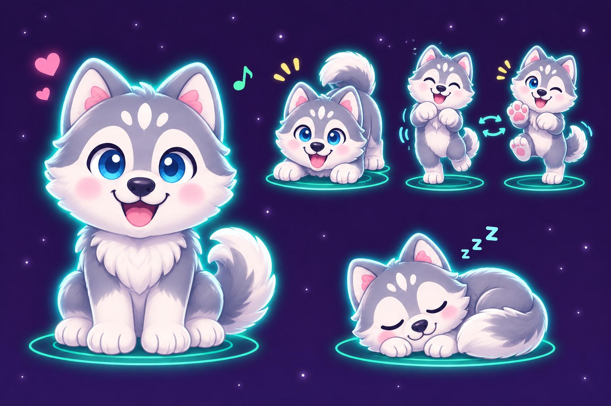

<!--
SPDX-License-Identifier: GPL-3.0-only
Copyright (C) 2026 Marcel Petrick <mail@marcelpetrick.it>
-->

# A husky friend for Mia: concept exploration

Parent: [more things to buy and pet ideas](https://github.com/marcelpetrick/Raumfreund/issues/9).
These pictures are concept art for discussion, not finished app assets. The
owner chose the name Flocke, and the current app unlocks her at level 3. The
quiet-star, alarm and privacy rules remain unchanged.

## Character

A cheerful, fluffy husky puppy with silver-grey and white fur, a white muzzle
and belly, perky ears and matching blue eyes. Match Mia's soft,
rounded shapes, child-friendly expressions, pastel colours and cyan glow.
The appearance should remain recognisable in all moods, including without
colour alone. The earlier concepts below had different-coloured eyes; they are
retained as historical references, not the current direction.

## Redesign: two matching blue eyes and a more canine appearance

The owner found Flocke too cat-like and asked for matching eyes and behavior
that feels like a dog. Siberian huskies can naturally have blue or brown eyes;
matching blue eyes keep the original cool palette. The [American Kennel Club's
breed description](https://www.akc.org/dog-breeds/siberian-husky/) documents
both eye colours.

Idea A makes the face more dog-like with a broader nose, open smile, chest ruff,
substantial legs and a bushy tail. The scared pose keeps a readable emotion;
its exaggerated folded ears are expressive concept art, not a requirement to
change the app's existing alarm rules.

Idea B explores a playful bow and alternating paws for a dog-specific dance.
Both concepts retain matching blue eyes, soft proportions, neon glow and the
same grey-and-white markings. The planned vector implementation combines the
clear muzzle and tail of A with the playful paw and bounce ideas of B. Keep
Mia's existing animation unchanged, and keep Flocke's stage and toy still.

The first sheet explores happy, uneasy, scared and sleeping poses, analogous
to Mia's states. The fear pose should be gentle rather than frightening.

The second sheet explores a playful dance, optional accessories, and friendship
with Mia. These are ideas, not promises of a toy, sound, purchase or multi-pet
mode. The pictured Mia is an illustrative concept, not a replacement design.

## Ten name ideas

1. Flocke
2. Wuschel
3. Taps
4. Fips
5. Pogo
6. Pixel
7. Lumi
8. Nori
9. Mochi
10. Keks

The owner chose **Flocke**. The other names are retained as earlier ideas.

## Production notes

The two images were generated with the built-in image generator using the
existing green-state screenshot of Mia as a style reference. The prompts asked
for a cute, blue-and-green-eyed husky in Mia's rounded pastel/neon style: the
first shows four moods; the second shows dancing, an accessory and a friendly
interaction with Mia. The two redesign sheets were also generated with the
built-in image generator from the original mood sheet: one prompt requested
matching blue eyes and canine moods; the other requested a playful bow, paw
dance and sleeping pose. Recreate and review the chosen direction in the app's
existing painter/animation system, including reduced-motion, accessibility,
layout and all four languages.
