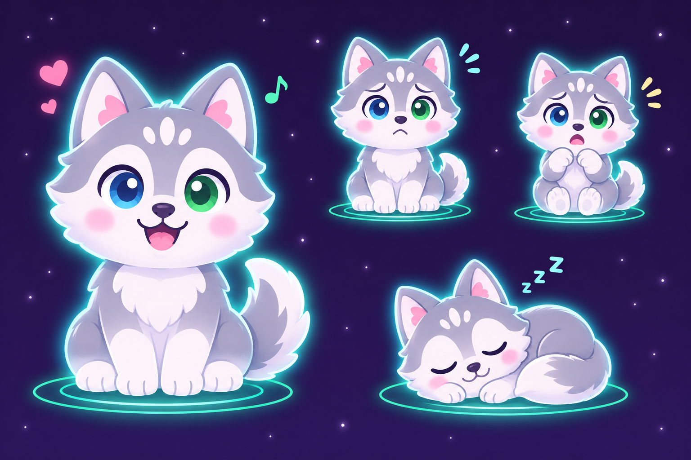
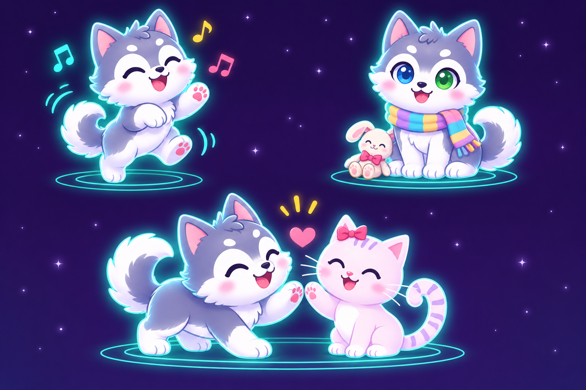

<!--
SPDX-License-Identifier: GPL-3.0-only
Copyright (C) 2026 Marcel Petrick <mail@marcelpetrick.it>
-->

# A husky friend for Mia: concept exploration

Parent: [more things to buy and pet ideas](https://github.com/marcelpetrick/Raumfreund/issues/9).
These pictures are concept art for discussion, not finished app assets or an
implemented feature. Mia's progress could eventually unlock a second pet; the
unlock level, how pet selection works, the final name and any shop items still
need decisions. The quiet-star, alarm and privacy rules stay unchanged.

## Character

A cheerful, fluffy husky puppy with silver-grey and white fur, a white muzzle
and belly, perky ears, and one blue eye and one green eye. Match Mia's soft,
rounded shapes, child-friendly expressions, pastel colours and cyan glow.
The appearance should remain recognisable in all moods, including without
colour alone. Keep the different-coloured eyes consistent when visible.

The first sheet explores happy, uneasy, scared and sleeping poses, analogous
to Mia's states. The fear pose should be gentle rather than frightening.

The second sheet explores a playful dance, optional accessories, and friendship
with Mia. These are ideas, not promises of a toy, sound, purchase or multi-pet
mode. The pictured Mia is an illustrative concept, not a replacement design.

## Ten name ideas

1. Flocke
2. Wuschel
3. Taps
4. Fips
5. Pogo
6. Pixel
7. Lumi
8. Nori
9. Mochi
10. Keks

No name has been chosen. Check pronunciation and suitability in German,
English, Croatian and Simplified Chinese before choosing one.

## Production notes

The two images were generated with the built-in image generator using the
existing green-state screenshot of Mia as a style reference. The prompts asked
for a cute, blue-and-green-eyed husky in Mia's rounded pastel/neon style: the
first shows four moods; the second shows dancing, an accessory and a friendly
interaction with Mia. A production character should be recreated and reviewed
in the app's existing painter/animation system, with reduced-motion,
accessibility, layout and all four languages considered.
